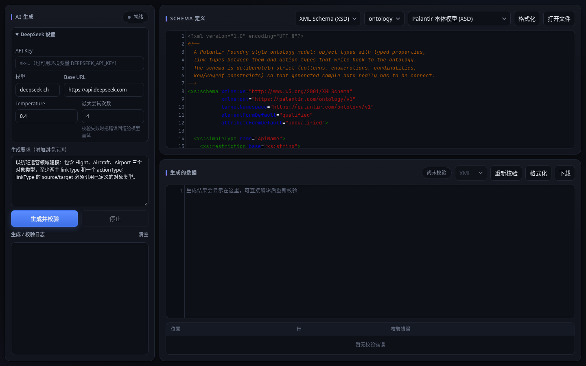
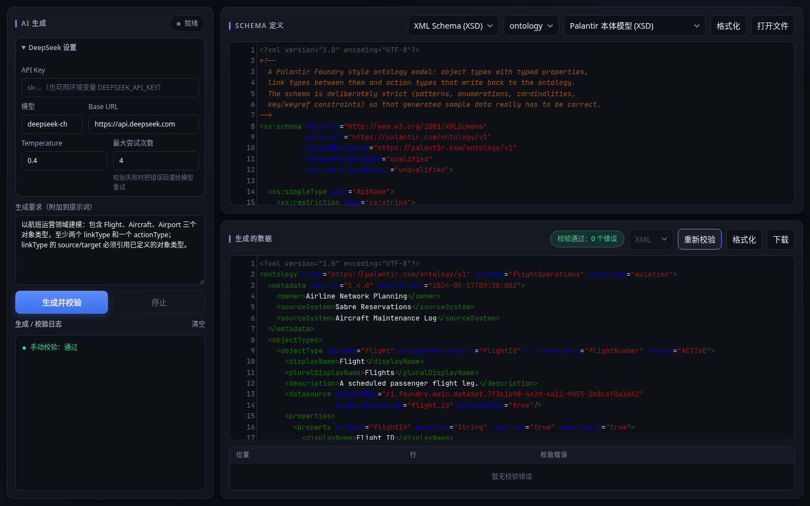
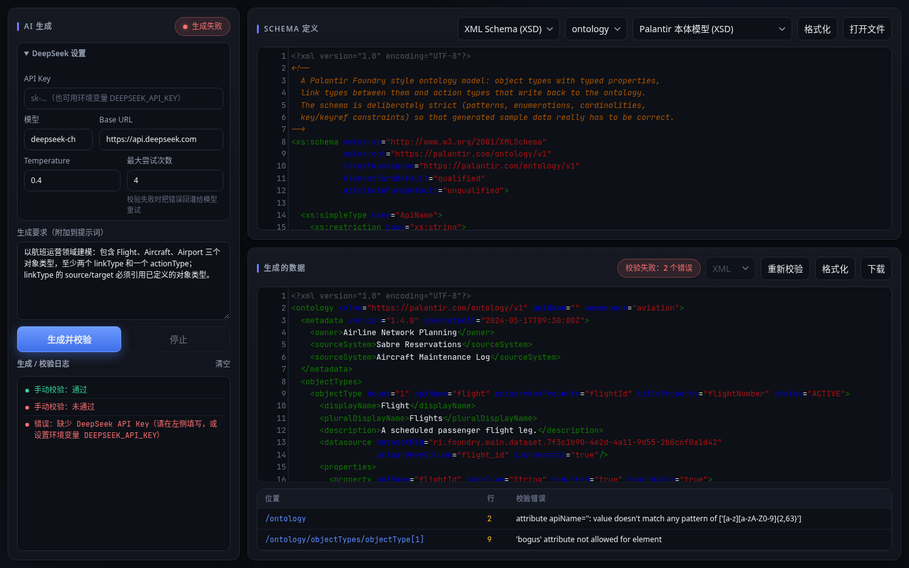

# Schema Data Forge

**English** | [简体中文](README.zh-CN.md)

A desktop editor that generates JSON / XML sample data from **JSON Schema** and **XML Schema (XSD)** with an LLM (DeepSeek), and **validates every result against the schema**. If the model's output fails validation, the validation errors go back to the model and it retries, up to a set number of attempts, until the document passes. The UI is a local FastAPI web app shown in a native window (pywebview) or in your browser. The UI is in Chinese.

## Features

- **Two schema types**: JSON Schema (validated with `jsonschema`) and XSD (validated with `xmlschema`), auto-detected; for XSD you pick the root element from the schema's global elements.
- **Generate → validate → repair loop**: each attempt is validated, and failures are sent back as feedback (default max 4 attempts). Progress streams to the log over server-sent events, and you can stop a run.
- **Model settings**: API key (or `DEEPSEEK_API_KEY`), model (`deepseek-chat` / `deepseek-reasoner`), base URL, temperature, max attempts, plus free-text generation instructions.
- **Editors**: CodeMirror editors for the schema and the generated data, with syntax highlighting, linting, bracket matching and XML tag folding; open a schema file, format, re-validate after manual edits, download.
- **Validation report**: a pass/fail badge and a table of errors with path, line and message.
- **Views**: show JSON output as JSON, YAML or TOML.
- **Bundled examples**: a Palantir-style ontology XSD and a Palantir-style object-set JSON Schema, each with suggested instructions.
- **Headless CLI** for scripting and end-to-end checks.
- **Installers**: PyInstaller builds for Windows (Inno Setup installer), macOS (`.dmg`) and Linux (`.deb`) through GitHub Actions.

## Screenshots

Captured from `python -m schema_data_forge.web` with headless Chromium. No DeepSeek API key was available, so the screenshots show validation of the repo's test fixture `tests/data/palantir_ontology_valid.xml` (and of a copy with two errors added on purpose), not live AI generation.

| Main window (XSD example loaded) | Valid document |
| --- | --- |
|  |  |
| **Validation errors (path / line / message)** | **Generate without an API key** |
|  |  |

## Tech stack

- Python ≥ 3.10, FastAPI + Uvicorn, httpx (DeepSeek chat completions in JSON mode)
- jsonschema, xmlschema, PyYAML, tomli-w
- Front end: plain HTML / CSS / JS with vendored CodeMirror 5
- Desktop window: pywebview (optional extra `desktop`); packaging with PyInstaller
- Dev tools: pytest, ruff, mypy (strict)

## Quick start

```bash
git clone https://github.com/gatesenman/schema-data-forge.git
cd schema-data-forge
python -m venv .venv && source .venv/bin/activate    # Windows: .venv\Scripts\activate

# Web UI in the browser (http://127.0.0.1:8765/)
pip install -e .
python -m schema_data_forge.web            # --host / --port to change

# Desktop window (pywebview)
pip install -e ".[desktop]"
schema-data-forge                          # --browser uses the default browser instead; --port 0 = free port

# Headless CLI
export DEEPSEEK_API_KEY=sk-...
schema-data-forge-cli --example palantir_ontology.xsd --out ontology.xml
schema-data-forge-cli --schema my.schema.json --instructions "10 records" --max-attempts 4
```

CLI options: `--schema` or `--example`, `--kind`, `--root-element`, `--instructions`, `--model` (default `deepseek-chat`), `--temperature` (default 0.4), `--max-attempts`, `--out`.

### Development

```bash
pip install -e ".[dev]"
ruff check . && ruff format --check .
mypy
pytest -m "not e2e"        # e2e tests call the live DeepSeek API and need DEEPSEEK_API_KEY
```

## Project structure

```
src/schema_data_forge/
├── generator.py        # generate → validate → repair loop
├── llm.py              # DeepSeek client (DEEPSEEK_API_KEY, https://api.deepseek.com)
├── validation.py       # JSON Schema / XSD validation, kind detection, root elements, formatting
├── models.py           # data classes (SchemaKind, ValidationReport, GenerationAttempt…)
├── examples.py         # bundled example schemas
├── example_schemas/    # palantir_ontology.xsd, palantir_object_set.schema.json
├── cli.py              # schema-data-forge-cli
├── desktop.py          # schema-data-forge (uvicorn thread + pywebview window)
└── web/
    ├── server.py       # FastAPI: /api/examples, /api/root-elements, /api/validate,
    │                   #          /api/format, /api/convert, /api/generate (SSE)
    └── static/         # index.html, app.js, styles.css, vendor/ (CodeMirror)
tests/                  # unit, web API and e2e tests
launcher.py             # PyInstaller entry point
installer.iss           # Inno Setup script for the Windows installer
assets/                 # app icons and earlier screenshots
```

## Configuration

| Setting | Where | Default |
| --- | --- | --- |
| API key | UI field, or env `DEEPSEEK_API_KEY` | — |
| Model | UI / `--model` | `deepseek-chat` |
| Base URL | UI | `https://api.deepseek.com` |
| Temperature | UI / `--temperature` | `0.4` |
| Max attempts | UI / `--max-attempts` | `4` |
| Web host / port | `python -m schema_data_forge.web --host --port` | `127.0.0.1` / `8765` |

## Contributing

Issues and pull requests are welcome. CI (`.github/workflows/ci.yml`) runs ruff, mypy and `pytest -m "not e2e"` on Python 3.12; please make sure they pass locally. Pushing a `v*` tag builds the installers (`release.yml`).

## License

No license file is included in this repository yet.
