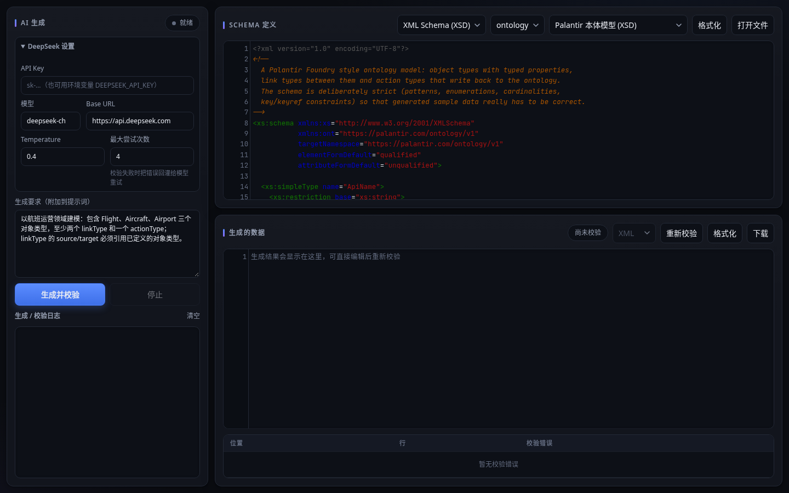
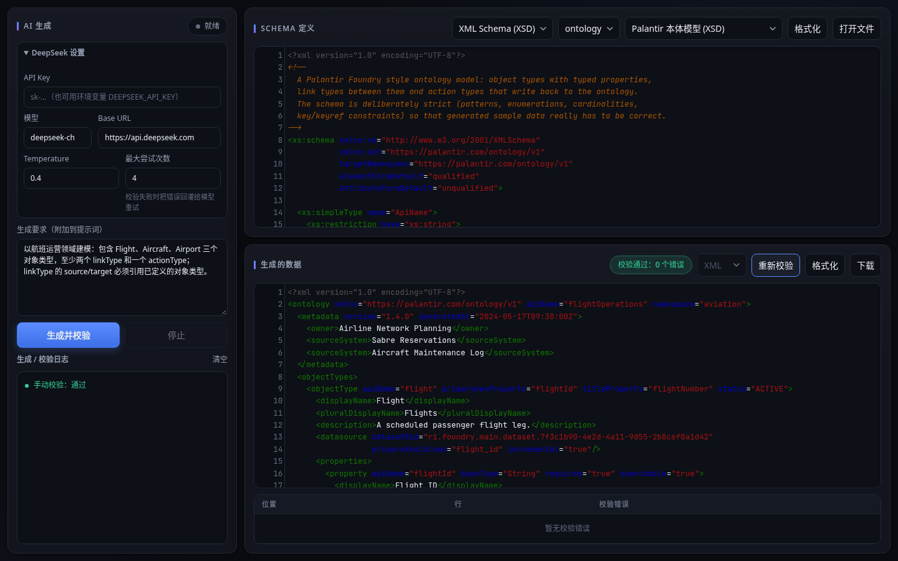
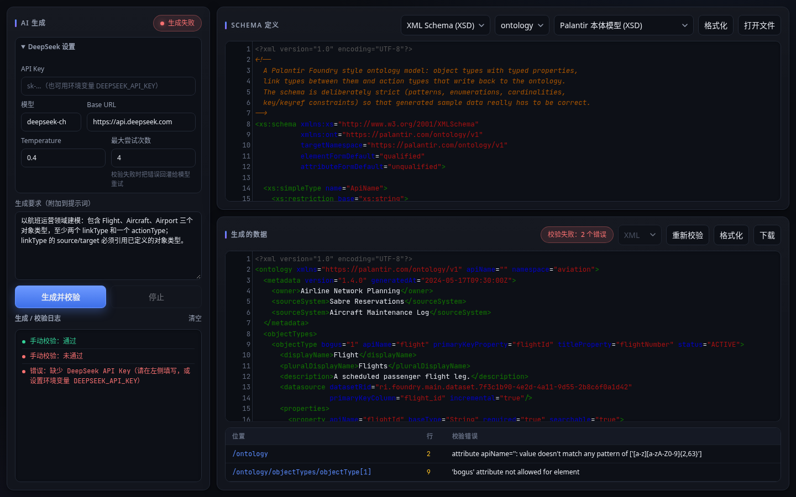

# Schema Data Forge

[English](README.md) | **简体中文**

一个桌面编辑器：用大模型（DeepSeek）根据 **JSON Schema** 和 **XML Schema（XSD）** 生成 JSON / XML 示例数据，并且**每次结果都强制经过 Schema 校验**。模型输出没通过校验时，会把校验错误反馈给模型重新生成，直到通过或达到最大尝试次数。界面是一个本地 FastAPI Web 应用，可以在原生窗口（pywebview）或浏览器中打开。

## 功能

- **两种 Schema**：JSON Schema（`jsonschema` 校验）与 XSD（`xmlschema` 校验），自动识别；XSD 可从全局元素中选择根元素。
- **生成 → 校验 → 修复循环**：每次生成都做校验，失败时把错误反馈给模型重试（默认最多 4 次）；进度通过 SSE 实时写入日志，可随时停止。
- **模型设置**：API Key（或环境变量 `DEEPSEEK_API_KEY`）、模型（`deepseek-chat` / `deepseek-reasoner`）、Base URL、Temperature、最大尝试次数，以及自由填写的生成要求。
- **编辑器**：Schema 与生成数据均使用 CodeMirror，支持语法高亮、Lint、括号匹配、XML 折叠；可打开 Schema 文件、格式化、手动修改后重新校验、下载。
- **校验报告**：通过 / 失败徽标，以及包含位置、行号、错误信息的错误表。
- **视图切换**：JSON 结果可切换为 JSON、YAML、TOML 显示。
- **内置示例**：Palantir 风格本体模型 XSD 与 Palantir 风格对象集合 JSON Schema，并附推荐生成要求。
- **命令行**：无界面生成，便于脚本和端到端检查。
- **安装包**：GitHub Actions 用 PyInstaller 构建 Windows（Inno Setup 安装程序）、macOS（`.dmg`）、Linux（`.deb`）。

## 截图

以下截图为 `python -m schema_data_forge.web` 启动后由无头 Chromium 实拍。由于没有 DeepSeek API Key，截图展示的是对仓库测试样例 `tests/data/palantir_ontology_valid.xml`（以及故意加入两处错误的副本）的校验，而不是真实的 AI 生成结果。

| 主界面（已加载 XSD 示例） | 校验通过 |
| --- | --- |
|  |  |
| **校验错误（位置 / 行号 / 信息）** | **未配置 API Key 时点击生成** |
|  |  |

## 技术栈

- Python ≥ 3.10，FastAPI + Uvicorn，httpx（以 JSON 模式调用 DeepSeek Chat Completions）
- jsonschema、xmlschema、PyYAML、tomli-w
- 前端：原生 HTML / CSS / JS + 内置 CodeMirror 5
- 桌面窗口：pywebview（可选依赖 `desktop`），PyInstaller 打包
- 开发工具：pytest、ruff、mypy（strict）

## 快速开始

```bash
git clone https://github.com/gatesenman/schema-data-forge.git
cd schema-data-forge
python -m venv .venv && source .venv/bin/activate    # Windows：.venv\Scripts\activate

# 浏览器中使用 Web 界面（http://127.0.0.1:8765/）
pip install -e .
python -m schema_data_forge.web            # 可用 --host / --port 修改

# 桌面窗口（pywebview）
pip install -e ".[desktop]"
schema-data-forge                          # --browser 改用默认浏览器；--port 0 自动选空闲端口

# 命令行
export DEEPSEEK_API_KEY=sk-...
schema-data-forge-cli --example palantir_ontology.xsd --out ontology.xml
schema-data-forge-cli --schema my.schema.json --instructions "生成 10 条记录" --max-attempts 4
```

CLI 参数：`--schema` 或 `--example`、`--kind`、`--root-element`、`--instructions`、`--model`（默认 `deepseek-chat`）、`--temperature`（默认 0.4）、`--max-attempts`、`--out`。

### 开发

```bash
pip install -e ".[dev]"
ruff check . && ruff format --check .
mypy
pytest -m "not e2e"        # e2e 测试会调用真实 DeepSeek API，需要 DEEPSEEK_API_KEY
```

## 项目结构

```
src/schema_data_forge/
├── generator.py        # 生成 → 校验 → 修复循环
├── llm.py              # DeepSeek 客户端（DEEPSEEK_API_KEY，https://api.deepseek.com）
├── validation.py       # JSON Schema / XSD 校验、类型识别、根元素、格式化
├── models.py           # 数据类（SchemaKind、ValidationReport、GenerationAttempt…）
├── examples.py         # 内置示例
├── example_schemas/    # palantir_ontology.xsd、palantir_object_set.schema.json
├── cli.py              # schema-data-forge-cli
├── desktop.py          # schema-data-forge（uvicorn 线程 + pywebview 窗口）
└── web/
    ├── server.py       # FastAPI：/api/examples、/api/root-elements、/api/validate、
    │                   #          /api/format、/api/convert、/api/generate（SSE）
    └── static/         # index.html、app.js、styles.css、vendor/（CodeMirror）
tests/                  # 单元测试、Web API 测试、e2e 测试
launcher.py             # PyInstaller 入口
installer.iss           # Windows 安装程序（Inno Setup）脚本
assets/                 # 应用图标与早期截图
```

## 配置

| 配置项 | 位置 | 默认值 |
| --- | --- | --- |
| API Key | 界面输入，或环境变量 `DEEPSEEK_API_KEY` | — |
| 模型 | 界面 / `--model` | `deepseek-chat` |
| Base URL | 界面 | `https://api.deepseek.com` |
| Temperature | 界面 / `--temperature` | `0.4` |
| 最大尝试次数 | 界面 / `--max-attempts` | `4` |
| Web 地址 / 端口 | `python -m schema_data_forge.web --host --port` | `127.0.0.1` / `8765` |

## 参与贡献

欢迎提 Issue 或 Pull Request。CI（`.github/workflows/ci.yml`）在 Python 3.12 上运行 ruff、mypy 和 `pytest -m "not e2e"`，提交前请在本地确认通过。推送 `v*` 标签会构建安装包（`release.yml`）。

## 许可证

仓库中暂未包含许可证文件。
